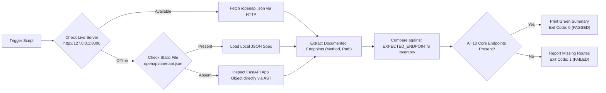

# Automation Guide: OpenAPI Documentation Consistency Checker
**Project:** REST API Design and Documentation Kit (Capstone 48)  
**Script Path:** `scripts/check_documentation.py`  

---

## 1. Purpose & Architecture of the Automation Tool
In enterprise software development, **API Contract Drift** is one of the most persistent and costly architectural failures. This occurs when backend developers modify route paths, change HTTP methods, or add/remove endpoints without synchronizing the API documentation or OpenAPI specification.

To solve this problem automatically, this project includes a dedicated automation tool: `scripts/check_documentation.py`.

### Architectural Flow:


---

## 2. How to Run the Script
The automation script runs with a single command on Windows, Linux, or macOS:

```bash
# Using active virtual environment Python
python scripts/check_documentation.py
```

### Optional Command-Line Arguments:
- `--url`: Custom base URL if the server is running on a non-default host or port:
  ```bash
  python scripts/check_documentation.py --url http://127.0.0.1:8080
  ```
- `--file`: Path to an alternate static OpenAPI JSON file:
  ```bash
  python scripts/check_documentation.py --file openapi/custom_spec.json
  ```

---

## 3. Sample Real Successful Execution Output
Below is the **actual output** generated by the script when validating our compliant application:

```text
======================================================================
  CAPSTONE 48: REST API DOCUMENTATION CONSISTENCY VERIFIER
======================================================================
[*] Spec Source: Local Spec File (openapi/openapi.json)
[*] Spec Title:  REST API Design and Documentation Kit
[*] Version:     1.0.0
----------------------------------------------------------------------

[+] Verified Documented Endpoints (11 total found):
  [REQUIRED]   DELETE /api/v1/books/{book_id}
  [EXTRA/DOC]  GET    /
  [REQUIRED]   GET    /api/v1/books
  [REQUIRED]   GET    /api/v1/books/{book_id}
  [REQUIRED]   GET    /api/v1/borrowings
  [REQUIRED]   GET    /health
  [REQUIRED]   PATCH  /api/v1/books/{book_id}
  [REQUIRED]   POST   /api/v1/books
  [REQUIRED]   POST   /api/v1/books/{book_id}/borrow
  [REQUIRED]   POST   /api/v1/books/{book_id}/return
  [REQUIRED]   PUT    /api/v1/books/{book_id}

----------------------------------------------------------------------
VERIFICATION SUMMARY:
[PASSED] All 10 required endpoints are correctly documented!
[PASSED] OpenAPI schema complies with REST API Design Kit requirements.

Result: Fully compliant with capstone specification (Exit code: 0).
```

---

## 4. Realistic Illustrative Failure Output
*(Note: The following failure block is an illustrative example demonstrating how the automation script flags missing routes and fails the build when an endpoint is accidentally deleted or commented out.)*

If a developer mistakenly removes or misnames the `DELETE` and `borrow` endpoints:

```text
======================================================================
  CAPSTONE 48: REST API DOCUMENTATION CONSISTENCY VERIFIER
======================================================================
[*] Spec Source: Live HTTP Server (http://127.0.0.1:8000)
[*] Spec Title:  REST API Design and Documentation Kit
[*] Version:     1.0.0
----------------------------------------------------------------------

[+] Verified Documented Endpoints (9 total found):
  [EXTRA/DOC]  GET    /
  [REQUIRED]   GET    /api/v1/books
  [REQUIRED]   GET    /api/v1/books/{book_id}
  [REQUIRED]   GET    /api/v1/borrowings
  [REQUIRED]   GET    /health
  [REQUIRED]   PATCH  /api/v1/books/{book_id}
  [REQUIRED]   POST   /api/v1/books
  [REQUIRED]   POST   /api/v1/books/{book_id}/return
  [REQUIRED]   PUT    /api/v1/books/{book_id}

----------------------------------------------------------------------
VERIFICATION SUMMARY:
[FAILED] 2 required endpoints are MISSING from OpenAPI documentation:

  [X] DELETE /api/v1/books/{book_id}          -> Delete book when permitted
  [X] POST   /api/v1/books/{book_id}/borrow   -> Borrow an available book

Result: Non-compliant with capstone specification (Exit code: 1).
```

### CI/CD Integration:
Because the script exits with `exit code 1` upon discovering discrepancies, modern CI/CD systems (such as GitHub Actions, GitLab CI, or Jenkins) will automatically block pull requests that introduce documentation drift.
